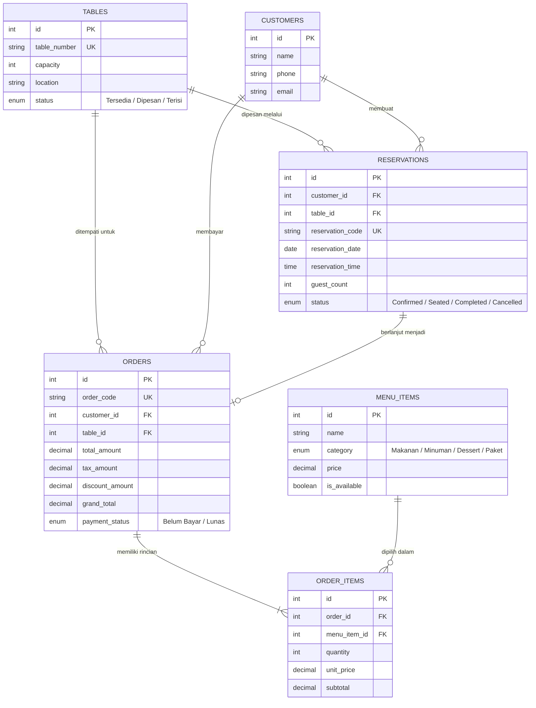

# DOKUMENTASI KODE PROGRAM SISTEM PEMESANAN RESTORAN
**Standar Kompetensi Kerja Nasional Indonesia (SKKNI) Bidang Pengembangan Perangkat Lunak**

Aplikasi ini dikembangkan untuk memenuhi kriteria unjuk kerja asesmen sertifikasi kompetensi programmer (BNSP / LSP) menggunakan **PHP Native Berorientasi Objek (OOP) & Terstruktur tanpa dependensi Composer**, dipadukan dengan library pre-existing modern.

---

## 1. Pemetaan Unit Kompetensi SKKNI

| No | Kode Unit | Judul Unit Kompetensi | Bukti Implementasi & Lokasi Berkas |
|---|---|---|---|
| 1 | **J.620100.016.01** | Menulis Kode dengan Prinsip Sesuai Guidelines dan Best Practices | Standar PSR-12, penamaan PascalCase & camelCase, komentar dokumentasi PHPDoc / DocBlock di seluruh class dan method. |
| 2 | **J.620100.017.02** | Mengimplementasikan Pemrograman Terstruktur | Validasi masukan & sanitasi XSS ([Validator.php](file:///c:/Users/dimas/Downloads/SERTIFIKASI/app/Core/Validator.php)), formatting helper modular ([FormatHelper.php](file:///c:/Users/dimas/Downloads/SERTIFIKASI/app/Helpers/FormatHelper.php)), kontrol alur if/switch/loop. |
| 3 | **J.620100.018.02** | Mengimplementasikan Pemrograman Berorientasi Objek | Class, Object, Encapsulation, Abstract Base Model ([Model.php](file:///c:/Users/dimas/Downloads/SERTIFIKASI/app/Core/Model.php)), Inheritance ([Table.php](file:///c:/Users/dimas/Downloads/SERTIFIKASI/app/Models/Table.php), [Order.php](file:///c:/Users/dimas/Downloads/SERTIFIKASI/app/Models/Order.php)), Interface Contract & Polymorphism ([CalculableInterface.php](file:///c:/Users/dimas/Downloads/SERTIFIKASI/app/Contracts/CalculableInterface.php)). |
| 4 | **J.620100.019.02** | Menggunakan Library atau Komponen Pre-Existing | **Bootstrap 5.3** (UI Grid & Modal), **FontAwesome 6.4** (Iconography), **SweetAlert2** (Pop-up alert interaktif), **Chart.js** (Visualisasi grafik statistik), **PHP PDO** (Data Access). |
| 5 | **J.620100.021.02** | Menerapkan Akses Basis Data | MySQL PDO Singleton ([Database.php](file:///c:/Users/dimas/Downloads/SERTIFIKASI/app/Config/Database.php)), Prepared Statements (anti-SQL Injection), Database Transactions (`beginTransaction`, `commit`, `rollBack`), Relasi Foreign Key. |
| 6 | **J.620100.023.02** | Membuat Dokumen Kode Program | Berkas dokumentasi ini (`DOKUMENTASI_KODE.md`), petunjuk instalasi (`README.md`), dan skema basis data (`database/schema.sql`). |
| 7 | **J.620100.025.02** | Melakukan Debugging | Global Error & Exception Handler ([ErrorHandler.php](file:///c:/Users/dimas/Downloads/SERTIFIKASI/app/Core/ErrorHandler.php)), file log otomatis ([logs/app.log](file:///c:/Users/dimas/Downloads/SERTIFIKASI/logs/app.log)), dan antarmuka inspeksi log visual (`index.php?page=logs`). |
| 8 | **J.620100.033.02** | Melaksanakan Pengujian Unit Program | Unit Test Framework Mandiri ([TestCase.php](file:///c:/Users/dimas/Downloads/SERTIFIKASI/tests/TestCase.php)), Test Suite ([OrderTest.php](file:///c:/Users/dimas/Downloads/SERTIFIKASI/tests/OrderTest.php), [TableTest.php](file:///c:/Users/dimas/Downloads/SERTIFIKASI/tests/TableTest.php)), Test Runner CLI & Web ([run_tests.php](file:///c:/Users/dimas/Downloads/SERTIFIKASI/tests/run_tests.php)). |

---

## 2. Diagram Hubungan Entitas (ERD - Entity Relationship Diagram)



---

## 3. Penjelasan Struktur Desain OOP & Arsitektur

### A. Singleton Pattern pada Koneksi Database (`app/Config/Database.php`)
Memastikan hanya ada satu objek koneksi PDO aktif selama lifecycle request aplikasi, menghemat penggunaan memory dan koneksi pool MySQL.
```php
$db = Database::getInstance()->getConnection();
```

### B. Pewarisan (Inheritance) & Abstraksi (`app/Core/Model.php`)
Abstract class `Model` menyediakan method CRUD dasar (`all()`, `find()`, `delete()`, `count()`) yang diwarisi oleh model anak seperti `Table`, `Customer`, `MenuItem`, `Reservation`, `Order`, dan `Report`.

### C. Antarmuka (Interface) & Polimorfisme (`app/Contracts/CalculableInterface.php`)
Model `Order` mengimplementasikan `CalculableInterface`:
```php
class Order extends Model implements CalculableInterface
{
    public function calculateSubtotal(): float { ... }
    public function calculateTax(float $taxRate = 10.0): float { ... }
    public function calculateGrandTotal(): float { ... }
}
```

### D. Keamanan Akses Basis Data (PDO Prepared Statement & Transaksi)
Semua query yang menerima masukan pengguna diproses menggunakan parameter binding (`:param`) untuk mencegah serangan SQL Injection. Transaksi database multi-tabel (reservasi & pesanan beserta item-itemnya) diapit oleh blok:
```php
$this->db->beginTransaction();
// eksekusi tabel master dan detail
$this->db->commit();
// jika gagal:
$this->db->rollBack();
```

---

## 4. Cara Menjalankan Pengujian Unit (Unit Testing)

Terdapat 2 opsi untuk menjalankan pengujian unit otomatis:
1. **Melalui Baris Perintah (Terminal / CLI):**
   ```bash
   php tests/run_tests.php
   ```
2. **Melalui Peramban Web (Browser):**
   Buka URL: `http://localhost:8000/tests/run_tests.php`
   Akan menampilkan kartu pengujian dengan status hijau **PASS** untuk setiap kasus uji.
