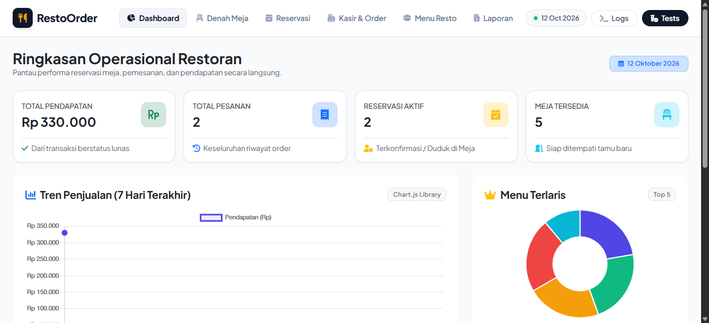
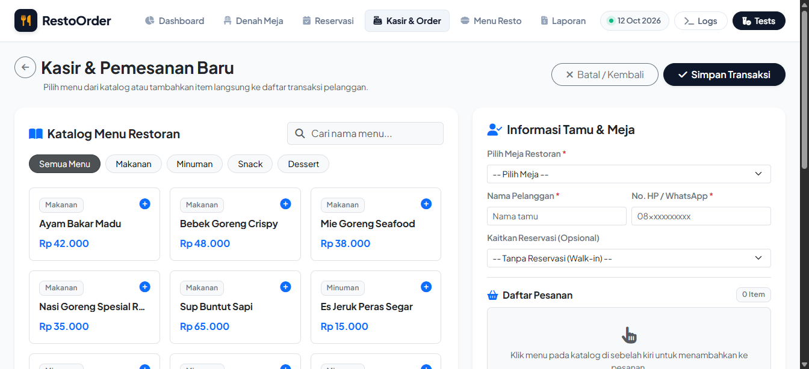
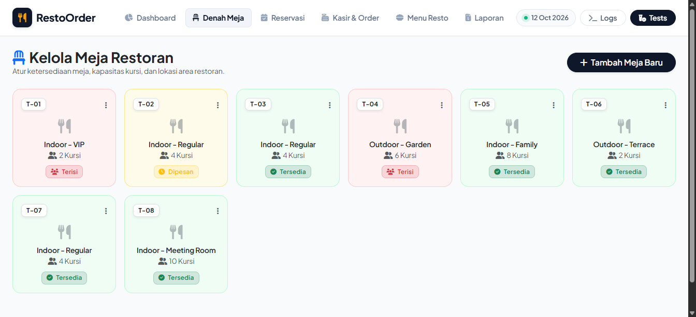
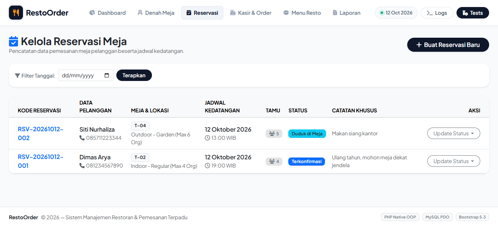
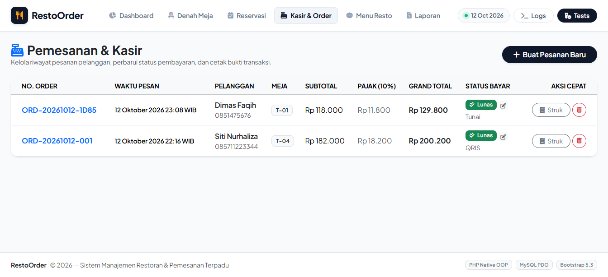
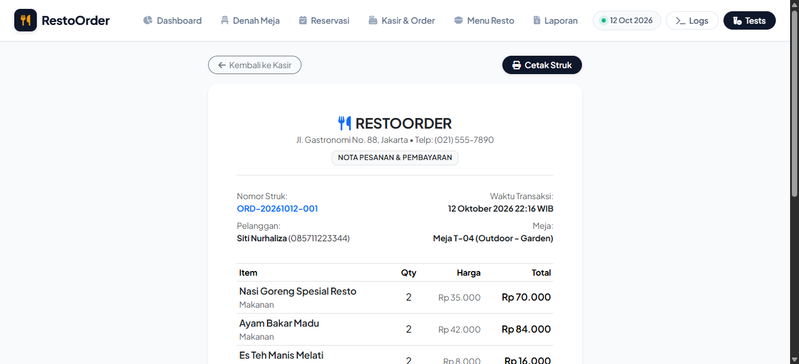
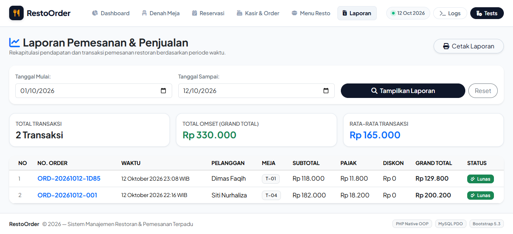
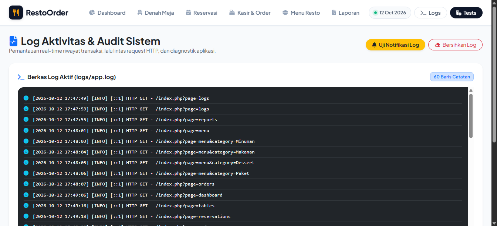
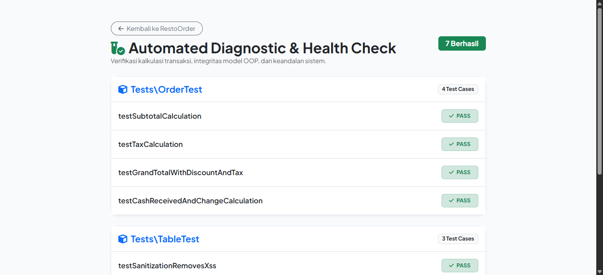
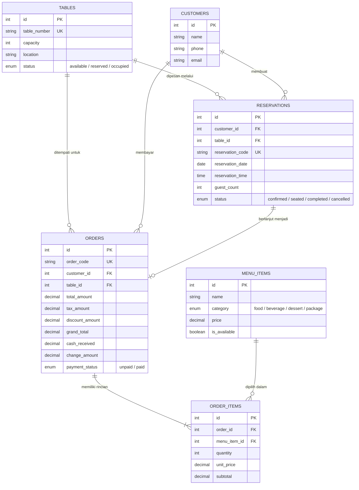

# 🍽️ RestoOrder Pro — Sistem Informasi Pemesanan Restoran

<p align="center">
  
  
  
  
  
</p>

Aplikasi berbasis web modern untuk pengelolaan operasional restoran terintegrasi: reservasi meja, pemesanan kasir point-of-sale (POS), perhitungan pajak & diskon otomatis, pencetakan struk transaksi, pelaporan keuangan, serta pencatatan audit log kesalahan sistem.

Dikembangkan secara khusus sebagai portofolio dan pemenuhan **Uji Praktik Demonstrasi Sertifikasi Kompetensi Programmer (BNSP / LSP)** dengan arsitektur **PHP Native Berorientasi Objek (OOP) & Terstruktur murni tanpa dependensi Composer (Zero-Vendor Footprint)**.

---

## 📸 Tangkapan Layar Aplikasi (Showcase)

| **Dashboard & Statistik** | **Point of Sale (Kasir)** |
|:---:|:---:|
|  |  |

| **Denah Meja Restoran** | **Reservasi Meja** |
|:---:|:---:|
|  |  |

| **Riwayat Pesanan & Transaksi** | **Struk Thermal Transaksi** |
|:---:|:---:|
|  |  |

| **Laporan & Grafik Omzet** | **Pemeriksaan Debug & Log** |
|:---:|:---:|
|  |  |

| **Unit Test Runner (Web & CLI)** |
|:---:|
|  |

---

## 🏆 Pemetaan 8 Unit Kompetensi SKKNI

Sistem ini dirancang untuk mendemonstrasikan secara nyata seluruh unit kompetensi dalam Skema Pemrogram (Programmer):

| No | Kode Unit | Judul Unit Kompetensi | Bukti Implementasi & Lokasi Berkas |
|:---:|---|---|---|
| 1 | **J.620100.016.01** | Menulis Kode dengan Prinsip Sesuai Guidelines dan Best Practices | Menerapkan standar konvensi PSR-12, penamaan camelCase/PascalCase, komentar PHPDoc di seluruh class/method, dan struktur kode bersih. |
| 2 | **J.620100.017.02** | Mengimplementasikan Pemrograman Terstruktur | Validasi masukan pengguna & sanitasi XSS (`app/Core/Validator.php`), modular helper format mata uang & tanggal (`app/Helpers/FormatHelper.php`), alur kontrol terstruktur. |
| 3 | **J.620100.018.02** | Mengimplementasikan Pemrograman Berorientasi Objek | Class, Object, Encapsulation, Abstract Base Model (`app/Core/Model.php`), Pewarisan/Inheritance model data (`app/Models/`), serta Interface Contract & Polymorphism (`app/Contracts/CalculableInterface.php`). |
| 4 | **J.620100.019.02** | Menggunakan Library atau Komponen Pre-Existing | Integrasi komponen UI modern: **Bootstrap 5.3**, ikon **FontAwesome 6**, notifikasi interaktif **SweetAlert2**, visualisasi grafik **Chart.js**, dan PHP Data Objects (**PDO**). |
| 5 | **J.620100.021.02** | Menerapkan Akses Basis Data | MySQL PDO Singleton (`app/Config/Database.php`), Prepared Statements (proteksi SQL Injection), dan Database Transactions ACID (`beginTransaction`, `commit`, `rollBack`). |
| 6 | **J.620100.023.02** | Membuat Dokumen Kode Program | Dokumentasi teknis terinci (`DOKUMENTASI_KODE.md`), petunjuk instalasi (`README.md`), dan skema perancangan DDL (`database/schema.sql`). |
| 7 | **J.620100.025.02** | Melakukan Debugging | Global Error & Exception Handler (`app/Core/ErrorHandler.php`), pencatatan audit log otomatis (`logs/app.log`), serta UI viewer log (`index.php?page=logs`). |
| 8 | **J.620100.033.02** | Melaksanakan Pengujian Unit Program | Custom Unit Test Runner mandiri (`tests/TestCase.php`), Test Suites (`tests/OrderTest.php`, `tests/TableTest.php`), eksekusi CLI & Web GUI (`tests/run_tests.php`). |

---

## 🏛️ Arsitektur & Desain Berorientasi Objek

### 1. Pola Singleton Koneksi Database
Mencegah pemborosan koneksi basis data dengan memastikan hanya ada satu instance PDO aktif selama siklus request:
```php
$db = Database::getInstance()->getConnection();
```

### 2. Abstraksi & Pewarisan (Inheritance)
Abstract Class `Model` (`app/Core/Model.php`) menyediakan logika umum CRUD (`all()`, `find()`, `delete()`, `count()`) yang diwarisi oleh model anak seperti `Customer`, `Table`, `MenuItem`, `Reservation`, `Order`, dan `Report`.

### 3. Kontrak Antarmuka (Interface) & Polimorfisme
Model `Order` mengimplementasikan `CalculableInterface` (`app/Contracts/CalculableInterface.php`) untuk menjamin konsistensi kontrak kalkulasi subtotal, pajak, diskon, dan grand total:
```php
class Order extends Model implements CalculableInterface
{
    public function calculateSubtotal(): float { ... }
    public function calculateTax(float $taxRate = 10.0): float { ... }
    public function calculateGrandTotal(): float { ... }
}
```

### 4. Transaksi Database (ACID)
Proses pembuatan transaksi pemesanan kasir melibatkan multi-tabel (`orders`, `order_items`, dan perubahan status meja pada `tables`), yang diproteksi menggunakan database transaction:
```php
$this->db->beginTransaction();
try {
    // 1. Simpan header order
    // 2. Simpan setiap order item
    // 3. Update status meja menjadi 'occupied'
    $this->db->commit();
} catch (\Throwable $e) {
    $this->db->rollBack();
    throw $e;
}
```

---

## 🗄️ Diagram Hubungan Entitas (ERD)



---

## 📁 Struktur Direktori

```text
RestoOrder/
├── app/
│   ├── Config/
│   │   └── Database.php             # Koneksi PDO Singleton (J.620100.021.02)
│   ├── Contracts/
│   │   └── CalculableInterface.php   # Interface Kontrak Kalkulasi (J.620100.018.02)
│   ├── Core/
│   │   ├── ErrorHandler.php         # Logging & Debugging Handler (J.620100.025.02)
│   │   ├── Model.php                # Abstract Base Model CRUD (J.620100.018.02)
│   │   └── Validator.php            # Validasi & Sanitasi Terstruktur (J.620100.017.02)
│   ├── Helpers/
│   │   └── FormatHelper.php         # Helper Format Mata Uang & Tanggal
│   └── Models/
│       ├── Customer.php             # Model Entitas Pelanggan
│       ├── MenuItem.php             # Model Entitas Menu Hidangan
│       ├── Order.php                # Model Pesanan & Kalkulasi POS
│       ├── Report.php               # Model Laporan & Agregasi Statistik
│       ├── Reservation.php          # Model Reservasi Meja
│       └── Table.php                # Model Meja & Kapasitas
├── assets/
│   ├── css/
│   │   └── style.css                # Kustomisasi Styling & Animasi
│   └── js/
│       └── app.js                   # Interaksi SweetAlert2 & Kalkulator POS
├── database/
│   ├── schema.sql                   # Skema DDL Relasional MySQL
│   └── seeder.sql                   # Data Awal Dummy Hidangan & Meja
├── doc_assets/                      # Tangkapan Layar UI untuk Dokumentasi
├── logs/
│   ├── .gitkeep
│   └── app.log                      # File Log Hasil Penanganan Error
├── tests/
│   ├── TestCase.php                 # Mini Test Framework Mandiri
│   ├── OrderTest.php                # Pengujian Unit Kalkulasi Pesanan
│   ├── TableTest.php                # Pengujian Unit Validasi & Sanitasi
│   └── run_tests.php                # CLI & Web Test Runner (J.620100.033.02)
├── views/
│   ├── layouts/
│   │   ├── header.php               # Template Navigasi & Metadata
│   │   └── footer.php               # Template Footer & Script Loader
│   ├── dashboard.php                # Beranda & Grafik Chart.js
│   ├── logs.php                     # Antarmuka Inspeksi Log Debugging
│   ├── menu.php                     # Manajemen Menu Makanan & Minuman
│   ├── orders.php                   # Layar Kasir / Pemesanan POS
│   ├── receipt.php                  # Cetak Struk Transaksi Thermal
│   ├── reports.php                  # Laporan Penjualan & Filter Periode
│   ├── reservations.php             # Manajemen Reservasi Meja
│   └── tables.php                   # Manajemen Denah & Status Meja
├── .gitignore                       # Filter Berkas Repository Git
├── DOKUMENTASI_KODE.md              # Dokumen Pemetaan Kode Program Lengkap
├── README.md                        # Dokumentasi Utama Repository
├── index.php                        # Controller Utama, Autoloader & Router
└── setup_db.php                     # Skrip Inisialisasi Otomatis Database
```

---

## ⚙️ Petunjuk Instalasi & Menjalankan

### 1. Prasyarat Sistem
- **PHP**: Versi 8.0, 8.1, atau 8.2 (dengan ekstensi `pdo_mysql` aktif).
- **Database**: MySQL Server 5.7+ / 8.0+ atau MariaDB 10.4+ (misal via XAMPP / Laragon).

### 2. Inisialisasi Basis Data (1 Langkah Otomatis)
Pastikan service MySQL Anda sudah aktif, lalu buka terminal pada direktori proyek dan jalankan:
```bash
php setup_db.php
```
*Skrip ini secara otomatis membuat basis data `db_restoran`, mengimpor skema relasional tabel, dan mengisikan data dummy seeder hidangan restoran.*

> **Catatan Konfigurasi:** Jika MySQL Anda memiliki password atau port berbeda, sesuaikan konstanta koneksi pada `app/Config/Database.php`.

### 3. Menjalankan Server Aplikasi
Anda dapat menggunakan PHP Built-in Server:
```bash
php -S localhost:8000
```
Buka browser dan akses: **[http://localhost:8000](http://localhost:8000)**

*(Atau letakkan direktori ini pada folder `htdocs` XAMPP / `www` Laragon dan buka `http://localhost/RestoOrder/`)*

---

## 🧪 Menjalankan Pengujian Unit (Unit Testing)

Terdapat dua cara untuk mengeksekusi pengujian otomatis:

### Opsi A: Melalui Command Line Interface (CLI)
```bash
php tests/run_tests.php
```
*Output di terminal akan menampilkan rincian eksekusi assertion dan rekap `7 Tests | PASSED: 7 | FAILED: 0`.*

### Opsi B: Melalui Browser (GUI)
Buka URL: **[http://localhost:8000/tests/run_tests.php](http://localhost:8000/tests/run_tests.php)**
*(Tersedia tombol akses cepat langsung dari menu navigasi atas aplikasi)*.

---

## 📄 Dokumen Asesmen Sertifikasi

Repositori ini melengkapi berkas deliverable utama uji sertifikasi kompetensi:
1. **Lampiran Koding**: Terangkum secara terstruktur pada repositori ini serta dokumen teknis pemetaan [`DOKUMENTASI_KODE.md`](DOKUMENTASI_KODE.md).
2. **Dokumen Laporan Pengembangan Program**: Diserahkan dalam format dokumen resmi (`.docx` / `.pdf`) sesuai template LSP.
3. **Slide Presentasi Demonstrasi**: Berkas slide pengujian & demonstrasi sistem (`.pptx` / `.pdf`) untuk sesi presentasi asesmen langsung.

---

## 👨‍💻 Pengembang
- **Nama Pengembang / Asesi**: Dimas
- **Repositori GitHub**: [https://github.com/DIMFAQ/RestoOrder](https://github.com/DIMFAQ/RestoOrder)
- **Skema Sertifikasi**: Pemrogram (Programmer) - Standar Kompetensi Kerja Nasional Indonesia (SKKNI)
